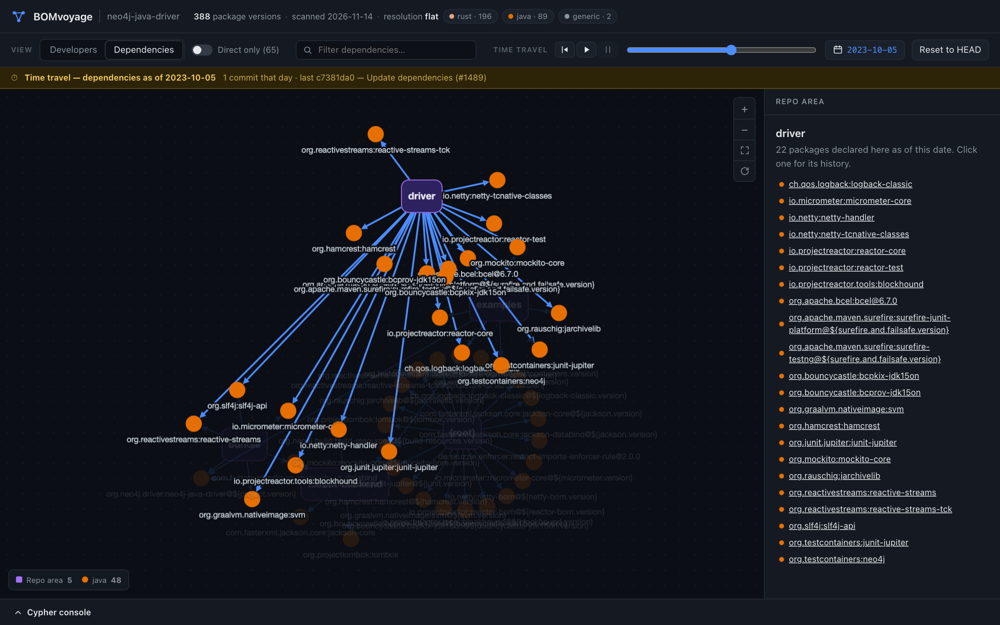

# BOMvoyage

[](https://github.com/b33f/BOMvoyage/actions/workflows/ci.yml)

**A temporal SBOM (Software Bill of Materials) generator and explorer — every dependency
has a story: who added it, when, and how it evolved.**

BOMvoyage is a single binary, powered by
**[RelateDB](https://relatedb.ai/)** by Neo4j — the embedded graph database that
lives inside the binary and writes the whole SBOM to one portable file.

Run it inside a git repository and it:

1. **Scans every dependency manifest** — Python (`requirements*.txt`, `pyproject.toml`,
   `poetry.lock`, `uv.lock`), Java (`pom.xml`, Gradle, `gradle.lockfile`), Rust
   (`Cargo.toml`, `Cargo.lock`), Go (`go.mod`, `go.sum`), Node.js / TypeScript /
   JavaScript (`package.json`, `package-lock.json`, `npm-shrinkwrap.json`, `yarn.lock`
   classic and Berry, `pnpm-lock.yaml` v5–v9).
2. **Walks the full git history** of those manifests and replays it, deriving for every
   dependency: **who added it, when, every version bump, and when it was removed** —
   stored as occupancy intervals on graph edges.
3. **Maps usage sites**: which files import / call each dependency.
4. **Builds the dependency graph** — direct and transitive (full pkg→pkg edges from
   `Cargo.lock` and the npm / yarn / pnpm lockfiles; module topology from `go.mod`; flat lockfiles are honestly marked
   `flat`, never faked into wrong edges).
5. Writes it all to **one portable `.rl` file** (RelateDB's Parquet snapshot + WAL
   bundle), then serves an **interactive web UI with time travel**.

## Quick start (the demo)

Download a prebuilt binary from [Releases](https://github.com/b33f/BOMvoyage/releases)
(macOS Apple-silicon & Intel, Linux x86_64, Windows x86_64 — each archive ships a
SHA-256 checksum), unpack it, and:

```console
$ cd some-git-repo
$ bomvoyage          # or ./bomvoyage-v0.1.0-… from the unpacked archive
scanning /some-git-repo …
412 packages across 87 commits, 634 dependency events, 1502 usage sites
wrote bomvoyage.rl
BOMvoyage explorer: http://localhost:8334   # opened in your browser automatically
```

Or build from source (see [Building](#building)).

Running with no options scans and opens the browser at `http://localhost:8334` on its own.
Open the URL: an interactive dependency graph with a **time-travel slider** — drag it
back to any commit and watch the SBOM shrink to what the repo depended on that day.
The sweep controls (⏮ ▶ ⏸) play the whole history day by day as an animation.
Click any package to see **who added it, when, its full version timeline, and every
file that uses it**; click a developer or repo-area hub to list the dependencies
attributed to it. The raw-Cypher box at the bottom shows the temporal query behind
the view you're looking at.

All screenshots below are real BOMvoyage sessions over the
[neo4j-java-driver](https://github.com/neo4j/neo4j-java-driver) repository
(388 package versions across 204 commits).

**The Developers view** — who added what, at `2023-10-05` mid-playback. Developer
hubs fan out to the packages they touched; the slider is mid-sweep:


**The Dependencies view** — the `driver` Maven module selected, its declared
packages highlighted and listed in the inspector:



**A package's story** — `org.slf4j:slf4j-api` as of `2021-08-18`: who added it and
when, its version timeline, and where it's used:


## Why a graph, and why embedded

A software bill of materials is a graph: manifests declare dependencies, lockfiles
resolve them, source files use them, and git history attributes them. Flat SBOM
formats throw the edges away; BOMvoyage keeps them — in
**[RelateDB](https://relatedb.ai/)**, an embedded openCypher graph engine that runs
in-process. No server to install, no cluster to babysit: the database is the `.rl`
file, and it opens anywhere with one call.

## Time travel

RelateDB has no native point-in-time queries, so time is **modeled in the graph**:
every temporal edge carries `{since_sha, since_date, removed_sha, removed_date}`, and
an "as-of" query is a Cypher predicate:

```cypher
MATCH (m:Manifest)-[r:DECLARES]->(p:Package)
WHERE r.since_date <= $as_of AND (r.removed_date IS NULL OR r.removed_date > $as_of)
RETURN p.purl, r.version_requirement, r.added_by_name
```

One scan builds the whole history; the present and every past moment are queries over
the same graph. Dates are git `%aI` ISO-8601 instants normalized to UTC, so string
comparison is chronological.

## CLI

```text
bomvoyage                                  # scan + serve (the demo path)
bomvoyage scan   [PATH] [--db bomvoyage.rl] [--force] [--max-commits N]
bomvoyage serve  [--db bomvoyage.rl] [--port 8334] [--open]
bomvoyage export [--db bomvoyage.rl] [--format spdx|cyclonedx|json|csv] [--as-of DATE|SHA] [-o FILE]
bomvoyage query  [--db bomvoyage.rl] <CYPHER>
```

`--as-of` accepts an ISO date (`2024-06-01`), an ISO datetime, a commit-sha prefix, or
`HEAD`. `export` and `query` open the database read-only; a re-scan of an unchanged
HEAD is a no-op (`--force` rescans; rescans are idempotent MERGEs on natural keys).

### Export standards

```console
$ bomvoyage export --format spdx --as-of 2024-01-01 -o sbom-jan.spdx.json
$ bomvoyage export --format cyclonedx -o sbom-now.cdx.json
```

SPDX 2.3 and CycloneDX 1.5, with dependency relationships, at any point in history.

## Query the graph

After a scan, the graph is open for read-only Cypher. Find the most-repinned
dependencies in whatever repo you just scanned:

```console
$ bomvoyage query --db bomvoyage.rl "MATCH (m:Manifest)-[r:DECLARES]->(p:Package)
  RETURN p.name AS name, count(*) AS versions ORDER BY versions DESC LIMIT 10"
```

Then pick a name from that list and replay its timeline — who added it, when,
every version bump. (`serde` below is a dependency of BOMvoyage itself — in a
repo without `serde`, substitute any name from the first query; a name that
isn't in the repo returns zero rows by design.)

```console
$ bomvoyage query --db bomvoyage.rl "MATCH (m:Manifest)-[r:DECLARES]->(p:Package {name: 'serde'})
  RETURN p.purl, r.version_requirement, r.since_date, r.added_by_name ORDER BY r.since_date"
```

## Design notes

- **A `Package` node IS a (name, ecosystem, version) triple**; `purl` (Package URL) is
  the natural key. A version bump is a new node, and the version timeline is the set of
  `DECLARES` intervals — "when did this dep change" is a one-hop query.
- **Transitive honesty**: `Cargo.lock` yields true pkg→pkg edges; `go.mod` yields the
  module topology it actually expresses; `poetry.lock`/`uv.lock`/`gradle.lockfile` are
  flat lists, so edges are synthesized from the root and the project is badged
  `flat` in the UI — a wrong edge is worse than a flat-but-true one in a security tool.
- **Git access shells out to `git`** (no libgit2): a pinned `-z`/record-separator
  `git log` invocation, byte-capped stdout, malformed records are errors.
- **No web framework**: the HTTP layer is hand-rolled over `std::net` and the UI
  (cytoscape.js) is embedded in the binary — fully offline, nothing to install.
- **Bounded by construction**: commit caps, 64 MiB manifest caps, usage-scan file caps;
  hitting a cap warns loudly instead of truncating silently.

## Building

You need Rust (1.88+) via [rustup](https://rustup.rs/), and `git` on your PATH.

> Cutting a release, or touching the CI / dependency graph? Read
> [RELEASING.md](RELEASING.md) first — it documents the release checklist
> (including the version bump in `Cargo.toml` that tags alone don't do) and
> the cross-compile setup for the Intel-Mac artifact.

**macOS** — the simplest path is the official script (it installs to
`~/.cargo/bin` and adds it to your shell's PATH for you):

```console
$ curl --proto '=https' --tlsv1.2 -sSf https://sh.rustup.rs | sh
```

Close and reopen your terminal (or `source "$HOME/.cargo/env"`), then verify:

```console
$ cargo --version
```

If you prefer Homebrew: `brew install rustup` does **not** put `cargo` on your
PATH automatically (the formula is keg-only), so add it and install a toolchain:

```console
$ brew install rustup
$ rustup default stable
$ echo 'export PATH="/opt/homebrew/opt/rustup/bin:$PATH"' >> ~/.zshrc
$ source ~/.zshrc
```

**Linux** (Debian/Ubuntu, Fedora, Arch — the official script works everywhere):

```console
$ curl --proto '=https' --tlsv1.2 -sSf https://sh.rustup.rs | sh
$ source "$HOME/.cargo/env"
```

**Windows** — download and run [rustup-init.exe](https://win.rustup.rs/), or:

```console
PS> winget install Rustlang.Rustup
PS> rustup default stable
```

(Windows also needs the MSVC build tools — rustup-init offers to install
"Visual Studio Community" with the right C++ workload if they're missing.)

Then, from a clone of this repository:

```console
$ cargo build --release
```

The finished binary lands at **`target/release/bomvoyage`** (relative to the clone).
A debug build (`cargo build`, faster to compile) lands at `target/debug/bomvoyage`.

> **Note:** the final release link step parallelizes across your cores and can sit
> near-silent on its last unit for ~15–30 seconds — that's normal, not a hang.


### What to do next

Run it with the full path, from inside any git repository you want to explore:

```console
$ cd /path/to/some/git/repo
$ /path/to/BOMvoyage/target/release/bomvoyage
```

It scans the repo, writes `bomvoyage.rl` into the current directory, and opens
`http://localhost:8334` in your browser.

If you'd rather just type `bomvoyage` from anywhere, install it onto your PATH
(from the clone):

```console
$ cargo install --path .          # installs to ~/.cargo/bin/bomvoyage
$ cargo uninstall bomvoyage       # to remove it again
```

(`~/.cargo/bin` is on your PATH if you installed Rust via rustup.)

Every scan you run leaves a `bomvoyage.rl` file next to where you ran it — that
file *is* the database. Re-running in the same repo with an unchanged HEAD is a
no-op; delete the file (or use `--force`) for a from-scratch scan.

The only runtime dependency that matters is [`relate`](https://crates.io/crates/relate)
— the RelateDB embedded openCypher graph engine
([relatedb.ai](https://relatedb.ai/)). Databases are single `.rl` files you can copy,
archive, or `scp` to a colleague.

## Tests

```console
$ cargo test                 # parser fixtures, interval replay, end-to-end git
                             # history → as-of queries, idempotent rescan
```

CI builds and tests every commit on **Linux, macOS and Windows** and runs the
lint checks (`cargo fmt`, `cargo clippy -D warnings`) plus a `cargo-deny`
supply-chain gate; a push of a `v*` tag
(e.g. `v0.1.0`) builds release binaries for all five targets and publishes them
as a GitHub release with SHA-256 checksums and signed build-provenance
attestations. The release process is documented in
[RELEASING.md](RELEASING.md).

## Security

See [SECURITY.md](SECURITY.md) for how to report a vulnerability and what the
tool's security model is (local-only binding, read-only Cypher enforcement,
treats repository content as untrusted data).

## License

Apache-2.0 — see [LICENSE](LICENSE).
