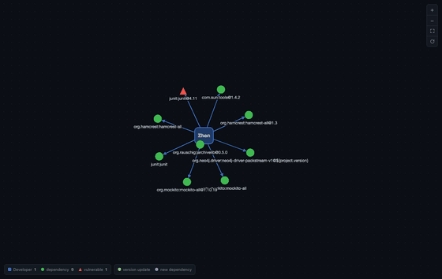
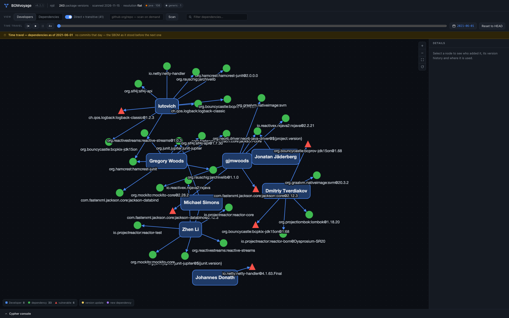
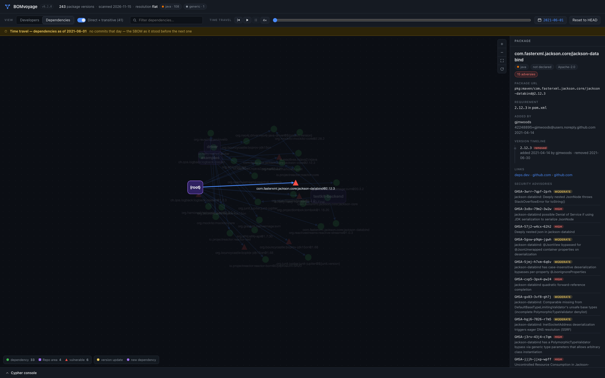

# BOMvoyage

[](https://github.com/b33f/BOMvoyage/actions/workflows/ci.yml)

**A temporal SBOM (Software Bill of Materials) generator and explorer — every dependency
has a story: who added it, when, and how it evolved.**

BOMvoyage is a single binary, powered by
**[RelateDB](https://relatedb.ai/)** by Neo4j — the embedded graph database that
lives inside the binary and writes the whole SBOM to one portable file.

Run it inside a git repository and it:

1. **Scans every dependency manifest** — Python (`requirements*.txt`, `pyproject.toml`,
   `poetry.lock`, `uv.lock`), Java (`pom.xml`, Gradle, `gradle.lockfile`), Rust
   (`Cargo.toml`, `Cargo.lock`), Go (`go.mod`, `go.sum`), Node.js / TypeScript /
   JavaScript (`package.json`, `package-lock.json`, `npm-shrinkwrap.json`, `yarn.lock`
   classic and Berry, `pnpm-lock.yaml` v5–v9).
2. **Walks the full git history** of those manifests and replays it, deriving for every
   dependency: **who added it, when, every version bump, and when it was removed** —
   stored as occupancy intervals on graph edges.
3. **Maps usage sites**: which files import / call each dependency.
4. **Builds the dependency graph** — direct and transitive (full pkg→pkg edges from
   `Cargo.lock` and the npm / yarn / pnpm lockfiles; module topology from `go.mod`; flat lockfiles are honestly marked
   `flat`, never faked into wrong edges).
5. Writes it all to **one portable `.rl` file** (RelateDB's Parquet snapshot + WAL
   bundle), then serves an **interactive web UI with time travel**.

## Quick start (the demo)

Download a prebuilt binary from [Releases](https://github.com/b33f/BOMvoyage/releases)
(macOS Apple-silicon & Intel, Linux x86_64, Windows x86_64 — each archive ships a
SHA-256 checksum), unpack it, and:

```console
$ cd some-git-repo
$ bomvoyage          # or ./bomvoyage-v0.1.0-… from the unpacked archive
scanning /some-git-repo …
412 packages across 87 commits, 634 dependency events, 1502 usage sites
wrote bomvoyage.rl
BOMvoyage explorer: http://localhost:8334   # opened in your browser automatically
```

Or build from source (see [Building](#building)).

Running with no options scans and opens the browser at `http://localhost:8334` on its own.
Open the URL: an interactive dependency graph with a **time-travel slider** — drag it
back to any commit and watch the SBOM shrink to what the repo depended on that day.
Time travel glides: packages that exist on both days keep their exact spot
(nothing moves on days where nothing changed), and on changed days the
remaining nodes animate smoothly to their new places. Arriving dependencies
flash their arrival colors (a second legend box beside the canvas legend
explains them): a **newly added dependency arrives purple**, a **version
update arrives yellow** on the replaced version's spot — each outlined in
pink while it lands, then fading to the package's standing color: **green**,
or **red** when the version ships with known security advisories (a
vulnerable package never animates as green).

**Time travel in motion** — dependencies arriving, version bumps landing
on the replaced version's spot, and the slow fade to each package's
standing color (graph only, 4× speed):



The sweep controls
(⏮ ▶ ⏸) play the whole history day by day as an animation — each step
waits for the day's motion to finish before advancing, so nothing is
chopped mid-glide — and **4×** quadruples the playback speed; pausing
freezes the frame instantly. Drag a developer or repo-area hub and, past
the first ~100px of travel, its dependencies come along as one unit.
Click any package to see **who added it, when, its full version timeline, and every
file that uses it**; click a developer or repo-area hub to list the dependencies
attributed to it. The raw-Cypher box at the bottom shows the temporal query behind
the view you're looking at. Ctrl+C shuts down cleanly: the explorer stops accepting
and waits (up to 2 minutes) for the background history walk to finish saving;
press Ctrl+C again to force-quit immediately.

All screenshots below are real BOMvoyage sessions over the
[neo4j-java-driver](https://github.com/neo4j/neo4j-java-driver) repository
(242 package versions across 317 commits), run in detailed mode
(`--detailed --vuln-details`) — packages render green, and any with known
security advisories break out as red triangles.

**The Developers view** — who added what, at `2021-06-01` mid-time-travel.
Developer hubs fan out to the packages they added; red triangles mark the
versions with known advisories:



**The Dependencies view** — the `driver` Maven module selected, its declared
packages highlighted and listed in the inspector:


**A package's story** — `com.fasterxml.jackson.core/jackson-databind@2.12.3`
as of `2021-06-01`: license, deps.dev / repository links, and its 15 security
advisories with severity chips, each linking to its osv.dev page:



## Why a graph, and why embedded

A software bill of materials is a graph: manifests declare dependencies, lockfiles
resolve them, source files use them, and git history attributes them. Flat SBOM
formats throw the edges away; BOMvoyage keeps them — in
**[RelateDB](https://relatedb.ai/)**, an embedded openCypher graph engine that runs
in-process. No server to install, no cluster to babysit: the database is the `.rl`
file, and it opens anywhere with one call.

## Time travel

RelateDB has no native point-in-time queries, so time is **modeled in the graph**:
every temporal edge carries `{since_sha, since_date, removed_sha, removed_date}`, and
an "as-of" query is a Cypher predicate:

```cypher
MATCH (m:Manifest)-[r:DECLARES]->(p:Package)
WHERE r.since_date <= $as_of AND (r.removed_date IS NULL OR r.removed_date > $as_of)
RETURN p.purl, r.version_requirement, r.added_by_name
```

One scan builds the whole history; the present and every past moment are queries over
the same graph. Dates are git `%aI` ISO-8601 instants normalized to UTC, so string
comparison is chronological.

## CLI

```text
bomvoyage                                  # scan + serve (the demo path)
bomvoyage --detailed                       # the same, with deps.dev data on the graph
bomvoyage scan   [PATH] [--db bomvoyage.rl] [--force] [--max-commits N]
bomvoyage serve  [--db bomvoyage.rl] [--port 8334] [--open]
bomvoyage export [--db bomvoyage.rl] [--format spdx|cyclonedx|json|csv] [--as-of DATE|SHA] [-o FILE]
bomvoyage query  [--db bomvoyage.rl] <CYPHER>
bomvoyage detailed [--db bomvoyage.rl] [--vuln-details] [--refresh]   # add deps.dev data to an existing graph, no rescan
bomvoyage site   [PATH] [--out dist]        # export a static in-browser explorer (WASM) for any static host
bomvoyage update check                      # is there a newer release?
bomvoyage update apply                      # upgrade the binary in place
bomvoyage skill install                     # install the agent skill for every coding agent on this machine
bomvoyage skill list                        # which agents are detected / installed
```

`--detailed`, `--vuln-details` and `--more-detailed` (= `--detailed
--vuln-details`, implying the first) are global flags — they work on the
default path, `scan`, and `serve` alike.

### Detailed mode (deps.dev) — optional, off by default

```console
$ bomvoyage --detailed
$ bomvoyage serve --detailed --vuln-details   # …with severity + summaries too
```

Detailed mode enriches every versioned package in the graph with live data
from the **deps.dev** API: the package's deps.dev page, its repository and
homepage links, its license (SPDX), and the security advisories that affect
that exact version. Packages with advisories are drawn as **red triangles**
in the explorer at HEAD and at every point on the time-travel slider — the
version keyed into the graph is the version whose advisories you see. All
other dependencies are drawn **green** (in every mode) so the triangles
stand out; shape carries the distinction too, for colorblind readers.
Clicking a package lists each advisory with a link to
its osv.dev page. On a detailed graph the Cypher console also gains a
prebuilt **"Vulnerable deps + who added them"** query — every dependency
with advisories at the slider's point in time, linked to the developer who
put that version there.

- **Privacy note:** detailed mode makes network calls. It sends each
  dependency's *name and version* to `api.deps.dev`, and each advisory ID to
  `api.osv.dev` (with `--vuln-details`) — third-party services, which
  therefore learn which packages your repository depends on. No source code,
  file paths, git history, or anything else ever leaves the machine.
  Detailed mode is off by default; all default paths are network-free apart
  from the optional update check.
- **`--vuln-details`** additionally fetches a severity label and a short
  summary per advisory — one extra call per *distinct* advisory, deduplicated
  across packages. **`--more-detailed`** is the shorthand for both tiers at
  once: it *implies* `--detailed`, so `bomvoyage --more-detailed` is the
  one-flag way to get the full works.
- **Cached**: responses are stored under `~/.cache/bomvoyage/` and reused
  forever (the data describes a package version, which doesn't change), so
  re-runs and the standalone `bomvoyage detailed` command are fast. Delete
  that directory, or pass `--refresh`, to re-fetch everything.
- **Fault-tolerant**: network trouble warns per package and never fails a
  scan. Undetailed graphs simply lack the data — nothing is cleared by a
  rescan without the flag.
- Requests to deps.dev can carry your own API key for a higher quota via the
  `BOMVOYAGE_DEPSDEV_KEY` environment variable.

### Static sites (WASM) — host the explorer on your own site

```console
$ bomvoyage site /path/to/repo --detailed --vuln-details --out dist
$ npx wrangler pages deploy dist        # Cloudflare Pages; any static host works
```

`bomvoyage site` scans the repository (fully, synchronously), runs detailed
mode, and writes a self-contained static site: the graph ships as a JSON
snapshot the page replays into the **WASM build of RelateDB**
(`@relate/relate-wasm`, vendored pinned-and-checksummed into the output) —
the whole explorer, including time travel, red-triangle vulnerabilities and
the Cypher console, runs in the browser with no server and no database
file. URLs are relative, so it works under a subpath of an existing site.
Note: the published artifact exposes the repository's dependency history,
including committer names and emails. The WASM engine is Chromium-tested
(upstream); other browsers untested.

### Self-update

BOMvoyage checks GitHub for a newer release **at most once a day**, in a
background thread that never blocks or fails the tool. When a new release
exists you get a one-line notice on the CLI and a banner box in the explorer
UI. `bomvoyage update apply` downloads the release archive for your platform,
verifies it against the release's published SHA-256 checksum, and replaces the
running binary in place — the new version runs on the next launch.

Opt out of the automatic check with `--no-update-check` (works on any
subcommand) or the environment variable `BOMVOYAGE_NO_UPDATE_CHECK=1`
(`true`/`yes`/`on` also accepted). The explicit `bomvoyage update check` /
`apply` commands always run regardless.

### Agent skill

`bomvoyage skill install` teaches the coding agents on this machine how to
drive BOMvoyage: it writes a `SKILL.md` (commands, the temporal graph model,
ready-to-run Cypher, agent-workflow notes) into every detected agent's skills
directory — Claude Code, Cursor, Windsurf, Copilot, Antigravity, Gemini CLI,
Cline, Codex, Pi, OpenCode, Junie and Kiro — detected by the presence of each
agent's config directory, so one command covers them all. The skill is
addressable as `self` (canonical) or `bomvoyage`; pass an agent name as the
positional and it's a hard error — target one explicitly with
`--agent claude-code` instead. Re-running the install updates the skill to
match the binary.

`--as-of` accepts an ISO date (`2024-06-01`), an ISO datetime, a commit-sha prefix, or
`HEAD`. `export` and `query` open the database read-only; a re-scan of an unchanged
HEAD is a no-op (`--force` rescans; rescans are idempotent MERGEs on natural keys).

### Export standards

```console
$ bomvoyage export --format spdx --as-of 2024-01-01 -o sbom-jan.spdx.json
$ bomvoyage export --format cyclonedx -o sbom-now.cdx.json
```

SPDX 2.3 and CycloneDX 1.5, with dependency relationships, at any point in history.

## Query the graph

After a scan, the graph is open for read-only Cypher. Find the most-repinned
dependencies in whatever repo you just scanned:

```console
$ bomvoyage query --db bomvoyage.rl "MATCH (m:Manifest)-[r:DECLARES]->(p:Package)
  RETURN p.name AS name, count(*) AS versions ORDER BY versions DESC LIMIT 10"
```

Then pick a name from that list and replay its timeline — who added it, when,
every version bump. (`serde` below is a dependency of BOMvoyage itself — in a
repo without `serde`, substitute any name from the first query; a name that
isn't in the repo returns zero rows by design.)

```console
$ bomvoyage query --db bomvoyage.rl "MATCH (m:Manifest)-[r:DECLARES]->(p:Package {name: 'serde'})
  RETURN p.purl, r.version_requirement, r.since_date, r.added_by_name ORDER BY r.since_date"
```

## Design notes

- **A `Package` node IS a (name, ecosystem, version) triple**; `purl` (Package URL) is
  the natural key. A version bump is a new node, and the version timeline is the set of
  `DECLARES` intervals — "when did this dep change" is a one-hop query.
- **Transitive honesty**: `Cargo.lock` yields true pkg→pkg edges; `go.mod` yields the
  module topology it actually expresses; `poetry.lock`/`uv.lock`/`gradle.lockfile` are
  flat lists, so edges are synthesized from the root and the project is badged
  `flat` in the UI — a wrong edge is worse than a flat-but-true one in a security tool.
- **Git access shells out to `git`** (no libgit2): a pinned `-z`/record-separator
  `git log` invocation, byte-capped stdout, malformed records are errors.
- **No web framework**: the HTTP layer is hand-rolled over `std::net` and the UI
  (cytoscape.js) is embedded in the binary — nothing to install. Default paths
  are fully offline apart from the optional daily update check; **detailed
  mode is the one opt-in network feature** (see the note above on what it
  sends and to whom).
- **Bounded by construction**: commit caps, 64 MiB manifest caps, usage-scan file caps;
  hitting a cap warns loudly instead of truncating silently.

## Building

You need Rust (1.88+) via [rustup](https://rustup.rs/), and `git` on your PATH.

> Cutting a release, or touching the CI / dependency graph? Read
> [RELEASING.md](RELEASING.md) first — it documents the release checklist
> (including the version bump in `Cargo.toml` that tags alone don't do) and
> the cross-compile setup for the Intel-Mac artifact.

**macOS** — the simplest path is the official script (it installs to
`~/.cargo/bin` and adds it to your shell's PATH for you):

```console
$ curl --proto '=https' --tlsv1.2 -sSf https://sh.rustup.rs | sh
```

Close and reopen your terminal (or `source "$HOME/.cargo/env"`), then verify:

```console
$ cargo --version
```

If you prefer Homebrew: `brew install rustup` does **not** put `cargo` on your
PATH automatically (the formula is keg-only), so add it and install a toolchain:

```console
$ brew install rustup
$ rustup default stable
$ echo 'export PATH="/opt/homebrew/opt/rustup/bin:$PATH"' >> ~/.zshrc
$ source ~/.zshrc
```

**Linux** (Debian/Ubuntu, Fedora, Arch — the official script works everywhere):

```console
$ curl --proto '=https' --tlsv1.2 -sSf https://sh.rustup.rs | sh
$ source "$HOME/.cargo/env"
```

**Windows** — download and run [rustup-init.exe](https://win.rustup.rs/), or:

```console
PS> winget install Rustlang.Rustup
PS> rustup default stable
```

(Windows also needs the MSVC build tools — rustup-init offers to install
"Visual Studio Community" with the right C++ workload if they're missing.)

Then, from a clone of this repository:

```console
$ cargo build --release
```

The finished binary lands at **`target/release/bomvoyage`** (relative to the clone).
A debug build (`cargo build`, faster to compile) lands at `target/debug/bomvoyage`.

> **Note:** the final release link step parallelizes across your cores and can sit
> near-silent on its last unit for ~15–30 seconds — that's normal, not a hang.


### What to do next

Run it with the full path, from inside any git repository you want to explore:

```console
$ cd /path/to/some/git/repo
$ /path/to/BOMvoyage/target/release/bomvoyage
```

It scans the repo, writes `bomvoyage.rl` into the current directory, and opens
`http://localhost:8334` in your browser.

If you'd rather just type `bomvoyage` from anywhere, install it onto your PATH
(from the clone):

```console
$ cargo install --path .          # installs to ~/.cargo/bin/bomvoyage
$ cargo uninstall bomvoyage       # to remove it again
```

(`~/.cargo/bin` is on your PATH if you installed Rust via rustup.)

Every scan you run leaves a `bomvoyage.rl` file next to where you ran it — that
file *is* the database. Re-running in the same repo with an unchanged HEAD is a
no-op; delete the file (or use `--force`) for a from-scratch scan.

The only runtime dependency that matters is [`relate`](https://crates.io/crates/relate)
— the RelateDB embedded openCypher graph engine
([relatedb.ai](https://relatedb.ai/)). Databases are single `.rl` files you can copy,
archive, or `scp` to a colleague.

## Tests

```console
$ cargo test                 # parser fixtures, interval replay, end-to-end git
                             # history → as-of queries, idempotent rescan
```

CI builds and tests every commit on **Linux, macOS and Windows** and runs the
lint checks (`cargo fmt`, `cargo clippy -D warnings`) plus a `cargo-deny`
supply-chain gate; a push of a `v*` tag
(e.g. `v0.1.0`) builds release binaries for all five targets and publishes them
as a GitHub release with SHA-256 checksums and signed build-provenance
attestations. The release process is documented in
[RELEASING.md](RELEASING.md).

## Security

See [SECURITY.md](SECURITY.md) for how to report a vulnerability and what the
tool's security model is (local-only binding, read-only Cypher enforcement,
treats repository content as untrusted data) — including what the opt-in
**detailed mode** network calls send to third parties (dependency names and
versions to deps.dev; advisory IDs to OSV) and what they deliberately do not.

Supply-chain gates on every PR: cargo-deny (RustSec advisories including
known-malicious crates, crates.io-only sources, permissive licenses,
checksummed-lockfile guards) and the Socket Security App (zero-day malicious
dependency heuristics) — both must pass to merge.

## License

Apache-2.0 — see [LICENSE](LICENSE).

All third-party crates distributed inside the binary are permissively
licensed; their inventory and license texts are in
[THIRDPARTY-NOTICES.md](THIRDPARTY-NOTICES.md), which also ships in every
release archive.
